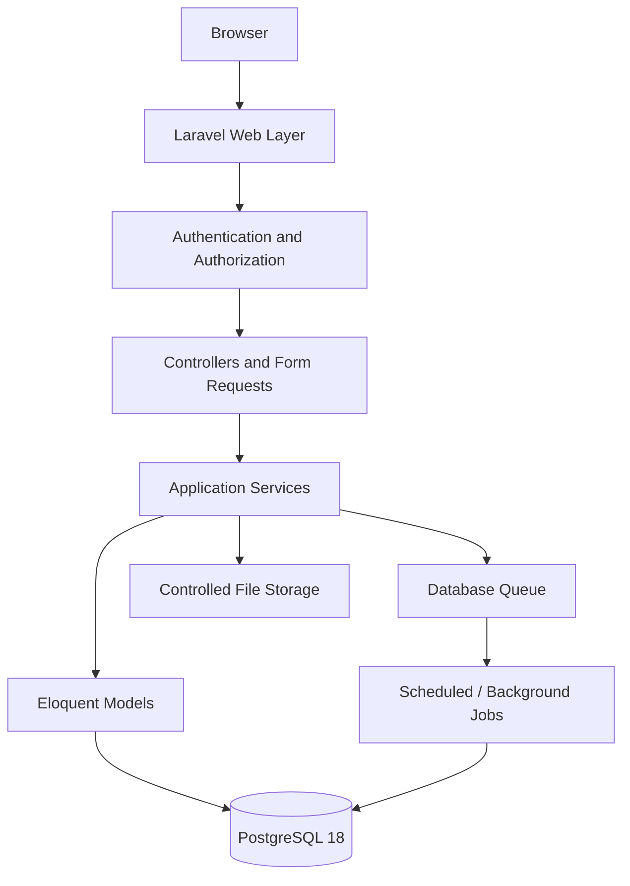

# Student Finance Manager

A personal finance application for tracking income, expenses, budgets, savings goals, debts and recurring transactions. The application is being migrated from procedural PHP and MySQL/MariaDB to **Laravel 13, PHP 8.5 and PostgreSQL 18**.

> **Migration branch:** `feature/laravel-13-postgresql-migration`. The original application remains on `main` as the legacy reference while the rebuild is developed and validated.

## Migration status

This branch contains the Laravel application foundation, PostgreSQL schema migrations and a legacy data migration plan. The original finance workflows are being ported incrementally; this branch is not yet a feature-complete replacement and is not ready for production data.

## Planned capabilities

- Secure registration, authentication and password recovery.
- Income and expense tracking.
- Monthly category budgets and budget alerts.
- Savings records and savings goals.
- Debt tracking.
- Recurring transactions with duplicate-safe processing.
- Notifications and achievement tracking.
- Monthly summaries, category analytics and financial reports.
- CSV/PDF exports.
- KES-first presentation with a path to configurable currencies.

## Architecture



## Technology

| Layer | Technology |
| --- | --- |
| Runtime | PHP 8.5 |
| Framework | Laravel 13 |
| Database | PostgreSQL 18 |
| Database access | Eloquent ORM |
| Frontend direction | Blade, Tailwind CSS, Alpine.js |
| Charts | Chart.js |
| Dependencies | Composer |
| Automated testing | PHPUnit |
| Code style | Laravel Pint |

## Requirements

- PHP 8.5 with PDO PostgreSQL, OpenSSL, Mbstring, Tokenizer, XML, Ctype, JSON and Fileinfo extensions.
- Composer 2.
- PostgreSQL 18.
- Node.js and npm when frontend assets are introduced.

## Local setup

1. Clone the repository and switch to the migration branch:

   ```bash
   git clone https://github.com/robinmwaniki/Student-finance-manager.git
   cd Student-finance-manager
   git checkout feature/laravel-13-postgresql-migration
   ```

2. Install PHP dependencies:

   ```bash
   composer install
   ```

3. Create local configuration:

   ```bash
   cp .env.example .env
   php artisan key:generate
   ```

   On Windows PowerShell, use `Copy-Item .env.example .env`.

4. Set PostgreSQL credentials in `.env`. Never commit this file.

5. Create a PostgreSQL database named `student_finance` and grant the configured user access.

6. Run migrations:

   ```bash
   php artisan migrate
   ```

7. Start the development server:

   ```bash
   php artisan serve
   ```

   Open http://localhost:8000.

## Database and legacy data

Laravel migrations define the new PostgreSQL schema. Legacy data is not imported by running `php artisan migrate`.

Read [docs/LEGACY-DATA-MIGRATION.md](docs/LEGACY-DATA-MIGRATION.md) before handling the old MySQL/MariaDB dump. It contains personal records and must be treated as sensitive. Never import it directly into production or publish copies of its data.

## Quality checks

```bash
php artisan test
vendor/bin/pint --test
```

Run PostgreSQL-backed integration tests before approving schema or data migration changes.

## Production readiness

Before launch, the project still needs complete authentication and authorization flows, the feature port, a validated data importer, test coverage, secure file storage, mail configuration, monitoring, scheduled recurring-transaction processing, backup/restore verification, CI and production web-server configuration.

## License

No license file is currently declared. Unless a license is added, standard copyright restrictions apply.

## Maintainer

**Robin Mwaniki** · [GitHub](https://github.com/robinmwaniki)
